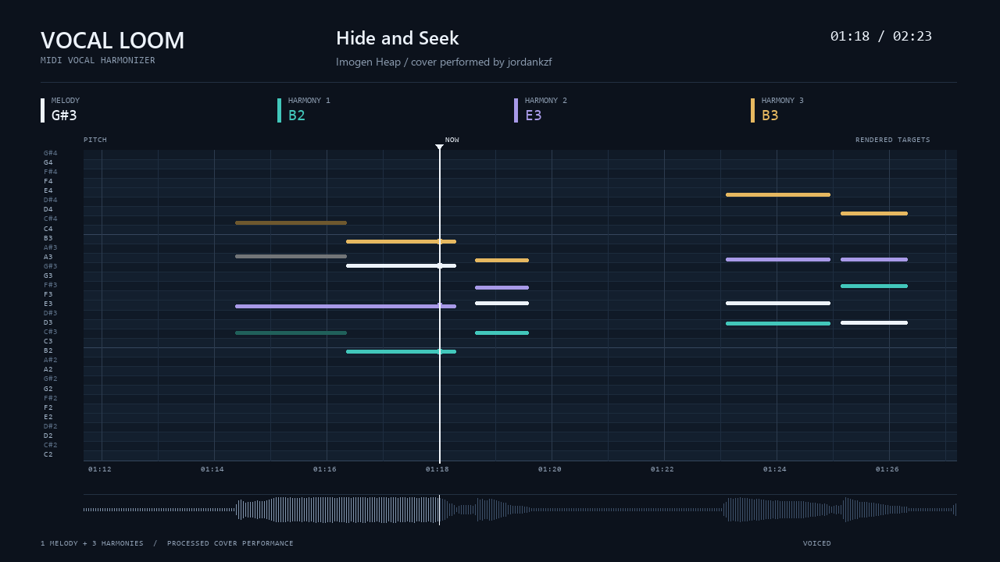

# VocalLoom: vocal harmonizer and MIDI pitch correction

Turn a dry singing recording and a MIDI score into a tuned solo, a two-voice duet,
or a four-voice vocal stack. VocalLoom combines vocal cleanup, pitch and timing
correction, generated harmonies, and WAV export in a Windows desktop interface
and Python command line. Optional lyric hints help with phrase and repeated-take
checks. Audio processing runs locally.

## Hear the result

<!-- demo-player:start -->
[](docs/demo/hide-and-seek-notes.mp4)
<!-- demo-player:end -->

[MP3 audio](docs/demo/hide-and-seek-demo.mp3) | [MP4 note visualization](docs/demo/hide-and-seek-notes.mp4)

**Song:** "Hide and Seek" by Imogen Heap. **Cover performance:** jordankzf.
This approved first-take example was made while developing the pipeline. It
combines the recorded lead with three generated harmony voices, editing, EQ,
compression, reverb, and loudness adjustment. The video shows the rendered note
targets for those four voices. Its soundtrack is the processed cover performance.

The media files are bundled here. GitHub's inline README player requires the MP4
to be uploaded as a GitHub attachment after the repository exists. The
[publishing checklist](docs/PUBLISHING.md) covers that step. For playback from a
local checkout, open [the demo player](docs/index.html) in a browser.

The project began as an exploration of the layered vocal effect on Imogen Heap's
"Hide and Seek". It is a general vocal-production tool, not an exact emulation of
the original processor. This is an early release; review the result by ear.

## What it does

- Reduces isolated mouth clicks and quiet breaths with context-aware cleanup.
- Estimates the sung register and aligns a performance to a MIDI score.
- Detects some repeated attempts using local transcription and a pitch guide.
- Offers transparent note-centre tuning and a tighter electronic tuning style.
- Arranges a duet harmony or three supporting parts from MIDI chord tones.
- Renders harmonies from the recorded voice using PSOLA or WORLD.
- Exports a tuned dry lead or a stereo mix with EQ, compression and reverb.
- Keeps stems, timing maps, tuning targets and edit reports for inspection.

The harmony arranger builds new parts from score chord tones and renders them
using your recorded voice. A four-voice stack means **one lead plus three
harmonies**. It does not require four separately recorded takes.

## Windows quickstart

Use 64-bit Python 3.12. That is the initially tested Python version on Windows;
other Python versions and platforms need their own validation. The standard
Windows Python installer includes Tkinter.

```powershell
py -3.12 -m venv .venv
.\.venv\Scripts\python.exe -m pip install .
.\.venv\Scripts\vocal-loom-ui.exe
```

You can also run `pipeline_ui.py` with the environment's Python, or use
`Start Vocal Loom.cmd` from a source checkout. The older `vocal-pipeline`
command names remain available for compatibility. No paid DAW or plugin is
required.

Select a fresh dry WAV/FLAC, a matching MIDI and a UTF-8 lyric file. Choose a
sound and output folder, then start the render. The interface reports progress,
can stop a render and can open the finished WAV. Record with headphones, leave
headroom and keep the backing track out of the microphone.

### Sounds

| Sound | Voices and processing |
|---|---|
| Tuned dry solo | One tuned lead on the recorded clock, with constant playback gain and no EQ, compression or reverb |
| Tuned solo | One corrected lead through the production chain |
| Duet | A corrected lead plus one higher harmony |
| Vocal stack | A lead plus three generated harmonies |

The desktop interface defaults to **Natural** tuning. Transparent correction
shifts note centres while retaining local movement such as vibrato and scoops.
Large moves, uncertain note assignments and unusual voice quality can still
produce audible artifacts. Natural is a processing style, not a guarantee of
imperceptible correction.

**Tight / electronic** tuning is available when a more quantized effect is
wanted. The command-line `--pitch-style auto` preset uses transparent tuning for
solo and duet, and tight tuning for vocal stacks. Choose a style explicitly to
override that preset.

The original-lead option preserves the cleaned, trimmed lead's samples before
the mix/master bus. Cleanup, trimming and mixing still affect the finished file.

## Command line

```powershell
# Produced solo
.\.venv\Scripts\vocal-loom.exe render --recording take.wav --midi score.mid --lyrics lyrics.txt --mode solo --out renders\solo

# Tuned dry lead with its recorded phrasing
.\.venv\Scripts\vocal-loom.exe render --recording take.wav --midi score.mid --mode solo --processing dry --pitch-style transparent --out renders\dry

# One upper harmony and a tuned lead
.\.venv\Scripts\vocal-loom.exe render --recording take.wav --midi score.mid --lyrics lyrics.txt --mode duet --pitch-style transparent --harmony-engine psola --out renders\duet

# Four-voice electronic vocal stack
.\.venv\Scripts\vocal-loom.exe render --recording take.wav --midi score.mid --mode vocoder --pitch-style tight --harmony-engine world --out renders\stack
```

Useful controls:

| Option | Purpose |
|---|---|
| `--melody-track auto` or an index | Infer or select the MIDI melody track |
| `--pitch-strength 0..1` | Set correction strength |
| `--pitch-style auto\|transparent\|tight` | Choose the tuning behaviour |
| `--harmony-engine auto\|psola\|world` | Choose harmony rendering |
| `--breath-reduction 0..1` | Set quiet-breath attenuation |
| `--lead-mode original` | Retain the cleaned lead's pitch and phrasing |
| `--language en` | Set transcription language; `auto` uses a multilingual model |
| `--no-asr` | Explicitly skip transcription and repeated-attempt detection |

Lyrics are optional hints, not forced syllable timestamps or executable
instructions. The tool does not invent missing sung words. `--transcript` accepts
a reviewed local ASR JSON, and `--alignment` accepts a reviewed source/MIDI timing
map. Run `vocal-loom render --help` for all options.

## Outputs and local processing

Each output folder contains `finished.wav`, `report.json`, `status.json` and a
`stages/` directory with stems, automation, cleanup and comping decisions.
Produced mixes are 24-bit stereo; dry exports are 24-bit mono. Original input
files are preserved. Use a new output folder for each song or attempt.

Transcription and audio processing run locally. First use downloads an upstream
speech model, which requires internet and disk space. The application does not
upload the recording. Models are cached in `.models` beside the installed
modules; a writable virtual environment is recommended. `--no-asr` avoids the
model download with the reduced behaviour described above.

The repository includes only the approved processed cover and generated synthetic
fixtures. Raw vocal takes, supplied song MIDI, full lyrics, transcripts, private
assessments, model weights and local environments are excluded. Treat your own
render folders and reports as private content.

## Limits and practical checks

A dedicated vocal-melody MIDI track gives the strongest reference. In a piano
arrangement, a higher accompaniment note may be mistaken for the vocal melody.
Repeated musical sections and large pitch errors also make automatic timing
uncertain. Inspect the warnings and listen to the result; a selected melody track
or reviewed timing map can override automatic choices.

Mouth-click and breath cleanup protects voiced sound and likely consonants.
Ambiguous noises may remain, while aggressive settings can soften diction.
Stationary noise reduction is applied only when the measured floor warrants it.
It cannot transparently repair clipped audio, strong room echo or backing-track
bleed.

Comping relies on imperfect transcription plus a pitch guide. It mutes selected
attempts with fades without moving the entire song. Review
`stages/take-comp.json`, particularly for intentional repetitions. Harmonies reuse
the source articulation and can sound synthetic on large shifts.

## Engines and tests

Continuous Praat TD-PSOLA handles lead correction and natural harmony rendering.
WORLD provides an alternative spectral-resynthesis texture. PSOLA/WORLD pitch
processing, Mido score parsing and local speech recognition are coordinated by
the Python pipeline. All third-party projects retain their own licences.

```powershell
.\.venv\Scripts\python.exe synthetic_fixture.py examples\synthetic
.\.venv\Scripts\python.exe -m unittest discover -p "test_*.py"
```

The generated five-note example uses synthetic harmonic vowels and fictional
text. Tests cover MIDI parsing, alignment, cleanup, comping, rendering and an
offline CLI path. They do not establish subjective sound quality for every
singer or song.

## Publishing and licence

[Publishing checklist](docs/PUBLISHING.md) | [Discovery and SEO notes](docs/SEO-NOTES.md)

Software is GPL-3.0-or-later. See [LICENSE](LICENSE) and [NOTICE](NOTICE).
The approved cover demo credits its underlying song separately; including the
performance does not relicense the composition. Dependency binaries and speech
model weights are not included in the source repository.
